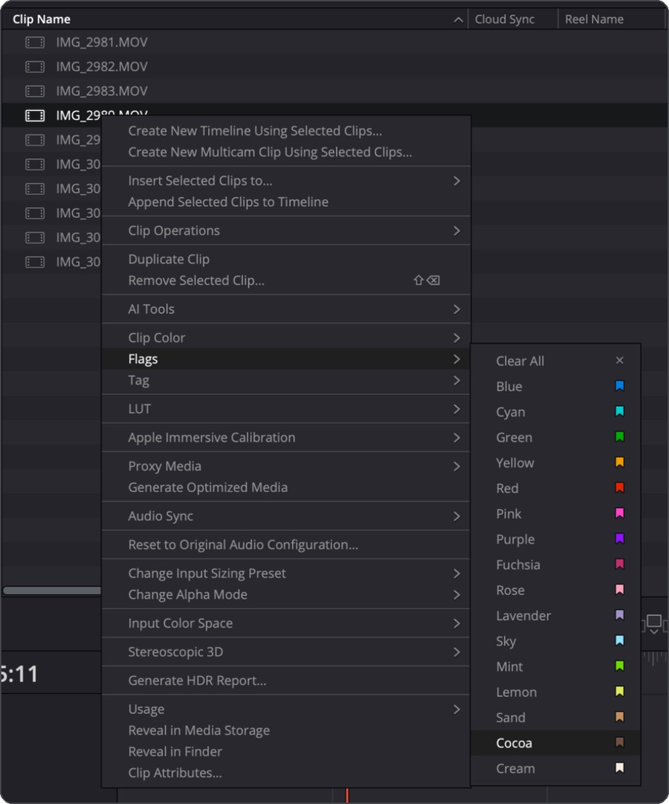
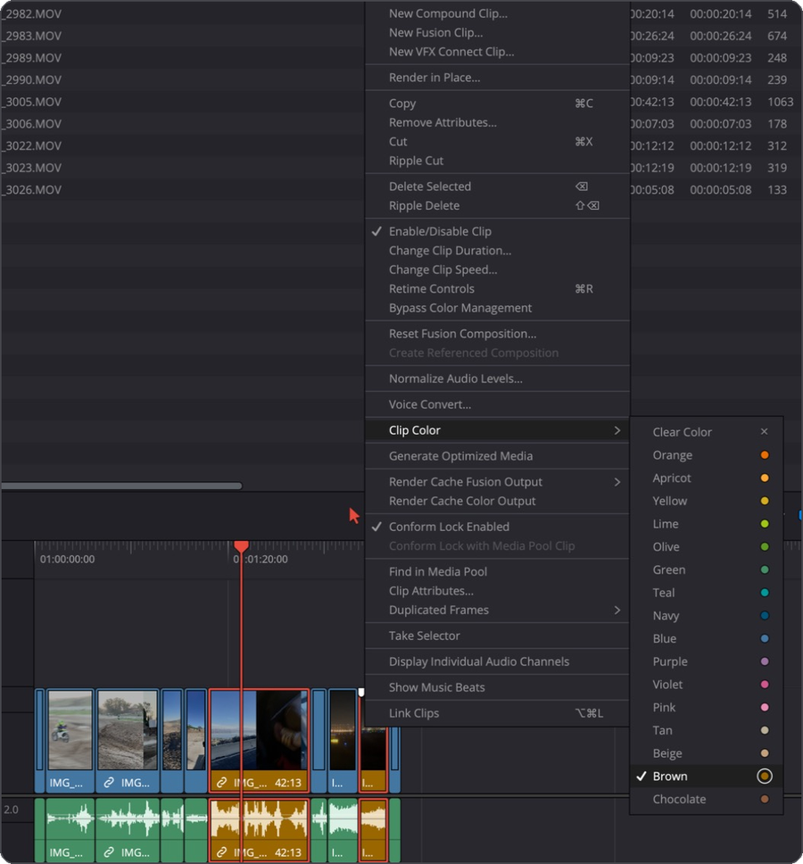
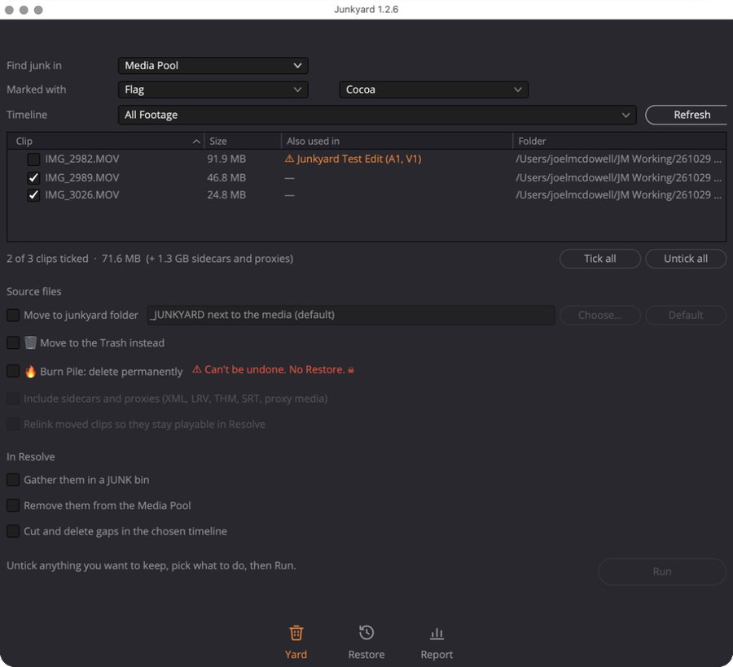
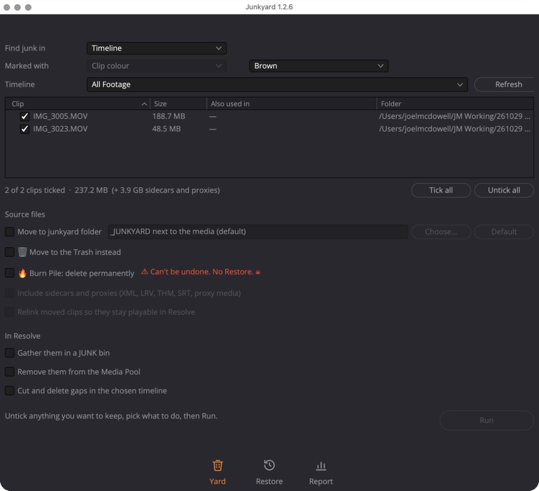
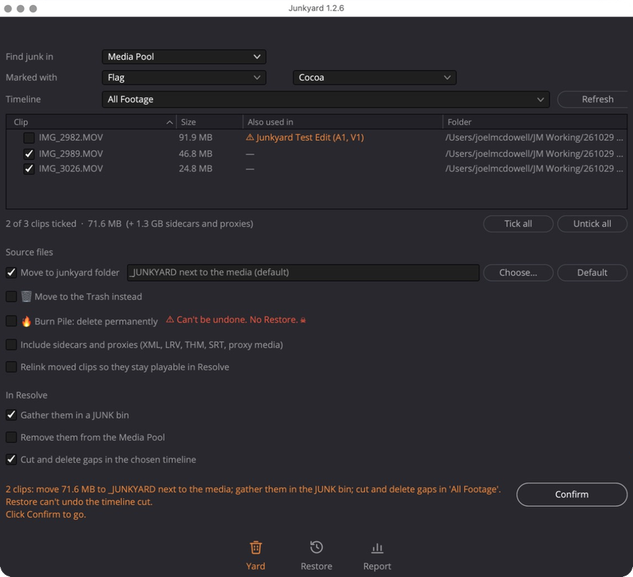
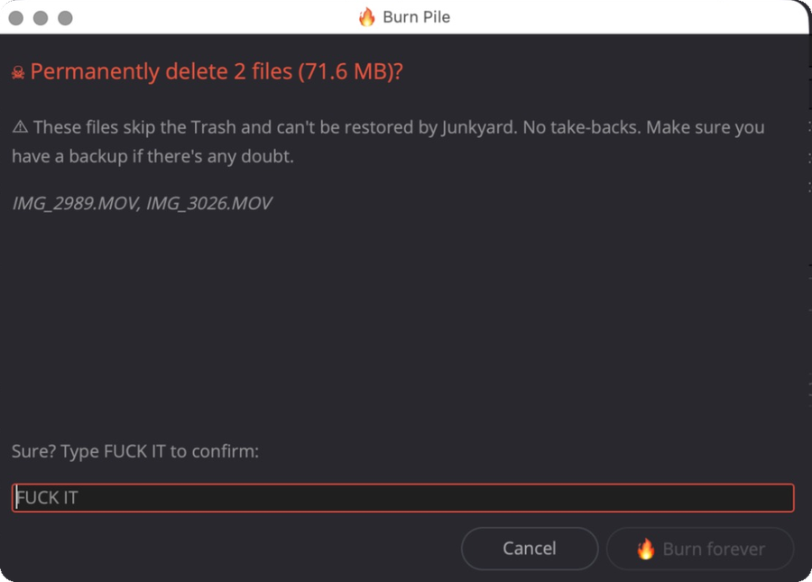
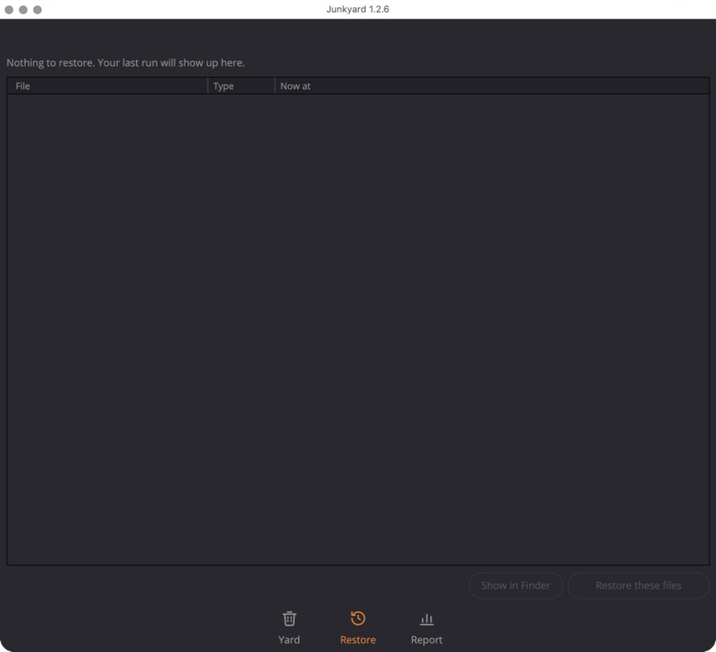
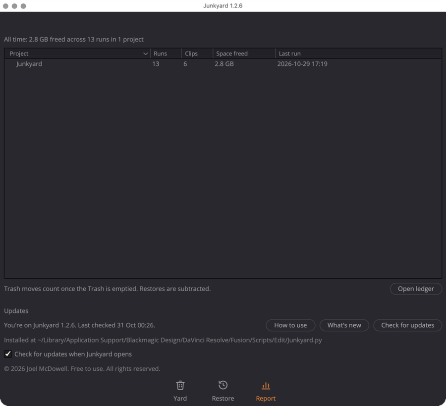

# How to use Junkyard

▶ **[Watch the 1-minute walkthrough](junkyard-walkthrough.mp4)**

Junkyard works on the project you have open in DaVinci Resolve Studio. The usual flow: put all your footage on one timeline, flag the takes you'll never use, then let Junkyard clear them out.

## 1. Flag your junk

In the Media Pool, right-click a clip › **Flags › Cocoa**. Do this for every clip you want gone.

You can pick a different flag or colour at the top of the Yard tab.

### Or mark junk straight on the timeline

Cutting down a stringout? Right-click a clip on the timeline › **Clip Color › Brown**. Resolve only lets you colour timeline clips, not flag them, so Junkyard looks for a colour here.

## 2. Open Junkyard and check the list

Open **Workspace › Scripts › Junkyard**. Pick your all-footage timeline and hit **Refresh**.

Every flagged clip shows with its size and folder. If a clip is also used in another timeline, it shows in **orange** with that timeline's name and starts unticked, so you don't wreck an edit. Untick anything you want to keep.

If you coloured clips on the timeline, set **Find junk in** to **Timeline**. Junkyard lists every Brown clip on the timeline you pick.

## 3. Choose what happens, then Run and Confirm

Every option starts off, so nothing happens that you didn't pick.

**Source files** (pick one)
- **Move to junkyard folder**: the safe choice. Files go to a `_JUNKYARD` folder next to your media so you can have a final look. Choose a different folder if you like.
- **Move to the Trash instead**: files go to the Mac Trash.
- **Burn Pile**: deletes them for good (see below).
- **Include sidecars and proxies**: takes the XML, LRV, THM, SRT and proxy files along too.
- **Relink moved clips**: keeps moved clips playable in Resolve.

**In Resolve**
- **Gather them in a JUNK bin**, or **Remove them from the Media Pool**.
- **Cut and delete gaps in the chosen timeline**: pulls them out of your stringout and closes up the gaps.

Hover over any option to see what it does.

Click **Run**. Junkyard spells out exactly what's about to happen, in orange, and the button turns into **Confirm**. Nothing moves until you click it. If you change anything after that, the plan clears and you click Run again.

## Burn Pile 🔥

Burn Pile skips the Trash and deletes the files permanently. Restore can't bring them back. After you Confirm, a pop-up lists the files, and **Burn forever** stays locked until you type `FUCK IT`.

## 4. Changed your mind? Restore

The **Restore** tab shows the files from your last run and where they went. **Restore these files** puts them back where they came from. (Restore can't undo a timeline cut or a Burn Pile.)

## 5. Report and updates

The **Report** tab adds up the space you've freed in each project. **Open ledger** shows the full history.

Junkyard checks for a new version when it opens and installs it in one click. **How to use** brings the in-app guide back, and **What's new** shows the latest changes.

## Tips

- Test on a copy of a project first, and keep backups of footage you care about.
- Clips moved to the Trash only count as space freed once you empty the Trash.
- Set a keyboard shortcut in **DaVinci Resolve › Keyboard Customization** (look under Workspace › Scripts) to open it faster.
