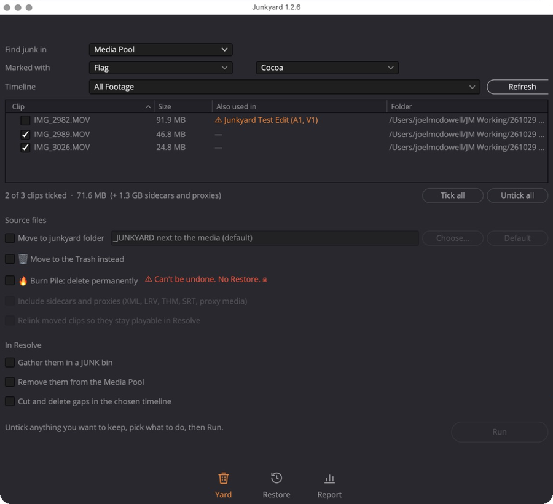

# Junkyard

Flag your junk footage in DaVinci Resolve Studio, then send the source files to the yard to free up space.

- Mark junk with a flag or clip colour, in the Media Pool or on a timeline
- Move the files to a `_JUNKYARD` review folder, the Trash, or (if you're sure) delete them for good
- Remove them from the Media Pool and cut them out of your all-footage timeline, closing the gaps
- Warns you when a clip is used in another timeline
- Restore puts the last run's files back
- One-click updates

## How to use

1. **Flag your junk.** In the Media Pool, right-click a clip › Flags › Cocoa. (Working on a timeline? Use Clip Color › Brown and set Find junk in to Timeline.)
2. **Open Junkyard** from Workspace › Scripts › Junkyard, pick your all-footage timeline and hit Refresh.
3. **Pick what happens** (every option starts off), click **Run**, check the plan (shown in orange), then **Confirm**.
4. **Changed your mind?** The Restore tab puts the last run's files back.

▶ [Watch the 1-minute walkthrough](docs/junkyard-walkthrough.mp4) · 📖 [Full guide with screenshots](docs/how-to-use.md)

## Install (Mac)

1. Click **Junkyard.py** in the file list above, then click the **Download raw file** button (the ⬇ arrow at the top right of the code). Don't use *Save Page As*, which saves the web page instead of the script.
2. In Finder press **Cmd + Shift + G**, paste this path and press Return:
   `~/Library/Application Support/Blackmagic Design/DaVinci Resolve/Fusion/Scripts/Edit/`
   (If the `Edit` folder isn't there, create it inside `Scripts`.)
3. Drag **Junkyard.py** into that folder.
4. In Resolve open **Workspace › Scripts › Junkyard**. Restart Resolve if it doesn't show yet.

Resolve needs Python 3 to run scripts: get it from [python.org](https://www.python.org/downloads/).

## Install (Windows)

Copy **Junkyard.py** to
`%APPDATA%\Blackmagic Design\DaVinci Resolve\Support\Fusion\Scripts\Edit\`

## Updates

Junkyard checks for a new version when it opens and installs it with one click. You can turn this off on the Report tab.

## Safety

Junkyard only moves files unless you choose Burn Pile, which asks you to type FUCK IT first. Test it on a copy of a project before using it on real work, and keep backups of footage you care about.

---

© 2026 Joel McDowell. Free to use. All rights reserved. Provided as is, with no warranty.
